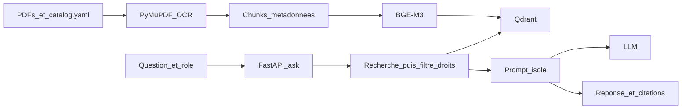

# L1.1 — Note de cadrage et architecture (étape 1)

## Objectif

MAINTiDOC V1 est un assistant de questions-réponses techniques (RAG textuel) pour
techniciens de maintenance. Il s’appuie sur un corpus PDF, des embeddings BGE-M3
et Qdrant. Il ne pilote aucun équipement et ne produit pas de diagnostic garanti.

Cette base est conçue pour être étendue :

- étape 2 : images / VLM ;
- étape 3 : LangGraph + MCP / tickets ;
- étape 4 : bot et déploiement.

## Périmètre étape 1

- Ingestion PDF page par page (PyMuPDF, OCR local en repli).
- Passages avec métadonnées : document, titre, version, page, famille, droits, hash.
- Index Qdrant.
- RAG LangChain avec **filtrage des droits avant** le LLM.
- API FastAPI `POST /ask` et UI Streamlit.

## Familles et droits

Familles : `pompes` (Grundfos), `variateurs` (Danfoss VLT).

Niveaux documentaires : `public`, `technicien`, `superviseur`.

| Rôle | Niveaux visibles |
| --- | --- |
| operateur | public |
| technicien | public, technicien |
| superviseur | public, technicien, superviseur |

Un document non autorisé n’entre ni dans le contexte ni dans les citations.

## Flux

## Isolation du contexte

Le prompt encadre les extraits dans `<document>…</document>` et demande d’ignorer
toute instruction trouvée dans les documents. Si le contexte est vide ou
insuffisant, la réponse est exactement « Je ne sais pas ».

## Schéma payload Qdrant

Collection `maintidoc_passages` (vecteurs 1024, cosine) :

- `document_id`, `title`, `version`, `page`
- `equipment_family`, `access_level`, `content_hash`, `text`

## Secrets

Aucun secret en dur. Fichier `.env` (non versionné) et `.env.example`.
