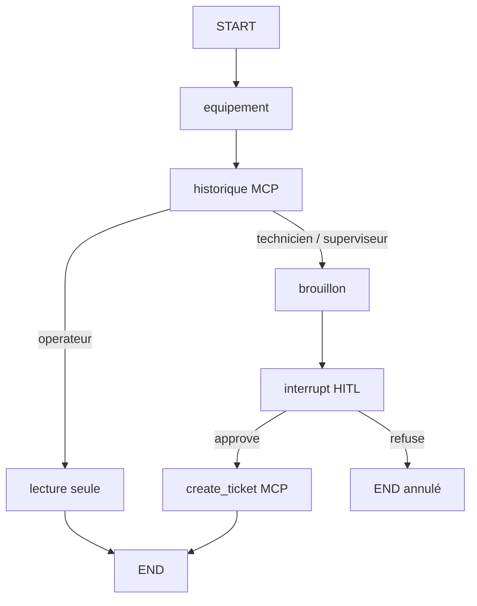

# L3.1 — Workflow LangGraph (étape 3)

Aucun pilotage machine. Un ticket n’existe qu’**après** approbation humaine.



## Tools MCP (`streamable-http` :8767)

| Tool | Rôle |
| --- | --- |
| `get_equipment_history` | Lecture GMAO |
| `get_open_tickets` | Tickets ouverts |
| `create_ticket` | Création **uniquement** avec `approval_token` |

Le jeton lie **utilisateur + rôle + équipement + titre + description**. Un opérateur est refusé. Même contenu → même ticket (idempotence).

## Lancer

```powershell
# terminal A — GMAO MCP
uv run python -m maintidoc.mcp_server

# terminal B — API (déjà Qdrant / Ollama)
uv run uvicorn maintidoc.api.app:app --app-dir src --host 127.0.0.1 --port 8001
```

Streamlit : onglet **Ticket GMAO** → Demander → **Approuver** ou **Refuser**.
